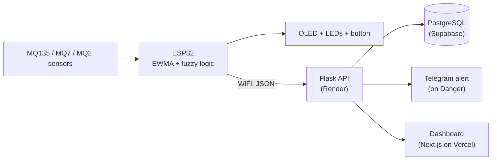

# IVEMPS-Lite

**IoT-based vehicle emission monitoring and prediction system: a low-cost, scaled prototype.**

Three gas sensors feed an ESP32 that rates the air **Safe / Warning / Danger** with fuzzy logic. Readings go over WiFi to a cloud API and database, a live dashboard shows them with a short-term forecast, and a Telegram alert fires on Danger. Built as a VTU final-year major project (CSE) under a ₹5,000 budget, following the architecture of:

> O. Farrag et al., "IVEMPS: IoT-Based Vehicle Emission Monitoring and Prediction System", *IEEE Access*, vol. 13, 2025. DOI: 10.1109/ACCESS.2025.3572726

- **Live dashboard:** https://ivemps-lite.vercel.app
- **API:** https://ivemps-lite-backend.onrender.com (free tier, the first request can take up to ~50 s to wake)

## Architecture



1. The ESP32 reads each sensor every 3 s (12-bit ADC), converts voltage to resistance, then to approximate ppm.
2. An exponentially weighted moving average (α = 0.2, as in the paper) smooths the readings.
3. Fuzzy logic (trapezoidal memberships) rates them Safe / Warning / Danger; the OLED and LEDs show it locally, with or without internet.
4. The reading is POSTed to the Flask API, stored in PostgreSQL, and a Telegram message is sent on Danger (5-minute cooldown).
5. `/forecast` projects the recent trend about 15 s ahead and rates it with the same fuzzy rules.
6. The dashboard polls the API every 5 s.

## Hardware

| Part | Role |
|---|---|
| ESP32 DevKit | Controller, WiFi |
| MQ135 / MQ7 / MQ2 | CO2 proxy / CO / smoke and hydrocarbon proxy |
| 0.96" SSD1306 OLED (I2C) | Local readout |
| Green + red LED (220 Ω), push button | Status lights (green Safe, red Danger, blinking Warning); button forces an immediate reading and upload |

| Signal | ESP32 pin |
|---|---|
| MQ135 / MQ7 / MQ2 analog out | GPIO34 / GPIO35 / GPIO32 (ADC1, safe with WiFi) |
| OLED SDA / SCL | GPIO21 / GPIO22 |
| Green LED / Red LED | GPIO18 / GPIO4 |
| Button | GPIO27 (to GND, internal pull-up) |

Sensors share one 5 V rail. Burn them in for about 24 h and allow 10-20 minutes to settle after any power-up.

## Fuzzy zones

Each gas belongs to Low / Medium / High with gradual overlaps. **Safe** = all Low, **Danger** = any High, otherwise **Warning**.

| Gas (ppm) | Low (fully) | Medium (fully) | High (fully) |
|---|---|---|---|
| CO2 | ≤ 8 | 14-24 | ≥ 30 |
| CO | ≤ 0.9 | 1.3-1.8 | ≥ 2.2 |
| Smoke / HC | ≤ 7 | 10-15 | ≥ 18 |

These boundaries match the calibrated sensor range, not the paper's industrial sensors. Keep `backend/app.py` (`ZONES`) and the firmware in sync if you change them.

## Repository layout

```
firmware/   ESP32 sketches (main firmware, calibration sketch)
backend/    Flask API, requirements.txt, Procfile
frontend/   Next.js dashboard
ml/         synthetic-data generator and model-training scripts
data/       logged sensor sessions (CSV)
docs/       report and slides
```

## Running it

**Firmware** (Arduino IDE 2.x, ESP32 board package by Espressif, libraries *Adafruit SSD1306* and *Adafruit GFX*)
1. Open the calibration sketch, run it in clean air for 2 minutes, and copy the printed `Ro_MQ135 / Ro_MQ7 / Ro_MQ2` into the main sketch.
2. Set `WIFI_SSID`, `WIFI_PASSWORD` and `BACKEND_URL` (ending in `/readings`) in the main sketch. Do not commit real credentials.
3. Upload. Recalibrate on site whenever the room or power source changes: MQ baselines shift.

**Backend**
```
cd backend
pip install -r requirements.txt
python app.py        # falls back to local SQLite when DATABASE_URL is not set
```
Environment variables for deployment: `DATABASE_URL` (use the `postgresql+psycopg2://` form), `TELEGRAM_BOT_TOKEN`, `TELEGRAM_CHAT_ID`, and `PYTHON_VERSION=3.11.9` on Render.

**Frontend**
```
cd frontend
npm install
npm run dev          # set BACKEND_URL at the top of app/page.js
```

**ML experiments**
```
cd ml
python generate_synthetic_data.py
python train_forecast_model.py
python train_from_real_data.py reading_export.csv
```

## Results (read the caveats)

**Forecast checked on one hour of real device data** (902 windows, 15 s ahead):

| Method | Accuracy | Danger F1 |
|---|---|---|
| Always say Safe | 87.5 % | 0.00 |
| Assume nothing changes | 92.0 % | 0.75 |
| Trend extrapolation + fuzzy rules (**live**) | 94.2 % | 0.75 |

Most of the session was Safe, so accuracy flatters every method; Danger F1 is the informative column. The session had only about 8 Warning and 3 Danger episodes, so these figures are indicative.

**RandomForest experiment.** A RandomForest trained on a synthetic driving-cycle dataset (same 10-reading window and 5-step horizon as the paper) scored accuracy 66.6 %, F1 0.68 and Danger F1 0.80. The paper's N-HiTS reports 83.3 %, 0.79 and 0.70 on real PEMS data, so the numbers are not directly comparable. On real data with blocked cross-validation the forest reached Danger F1 of only 0.07 (too few events), which is why the live forecaster is the trend method.

## Limitations

- No CAN bus / OBD-II link (a gap the paper targets).
- MQ sensors give reliable *relative* change, not lab-exact ppm; MQ7 runs at constant heater voltage; the smoke channel is an index, not true ppm. Readings are capped at 10,000 ppm.
- Three gases only; no real-vehicle test; open breadboard prototype.
- No device authentication or offline SD logging.
- Free-tier cloud: Render sleeps when idle, Supabase pauses after 7 days of inactivity.

## Future work

OBD-II logging alongside the gases, dedicated sensors for NO / NO2 / H2S / O2, validation against a reference analyser, tailpipe sampling with a moisture trap and airflow, a longer multi-session dataset to retrain and re-compare the ML model, device authentication and SD buffering.

## Author

Vijaysimha, CSE, R R Institute of Technology, Bangalore (VTU).
